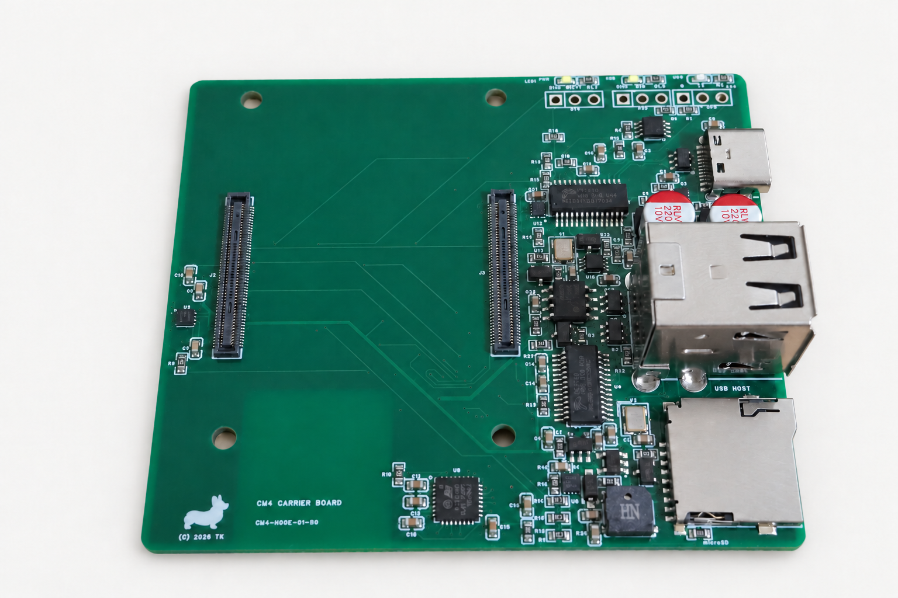
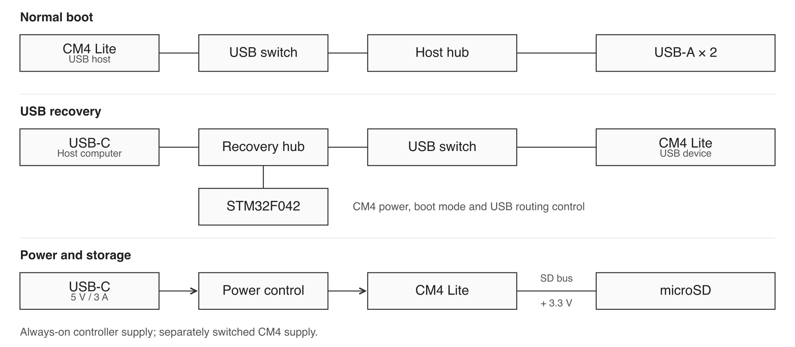
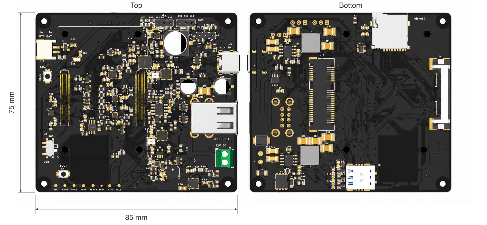
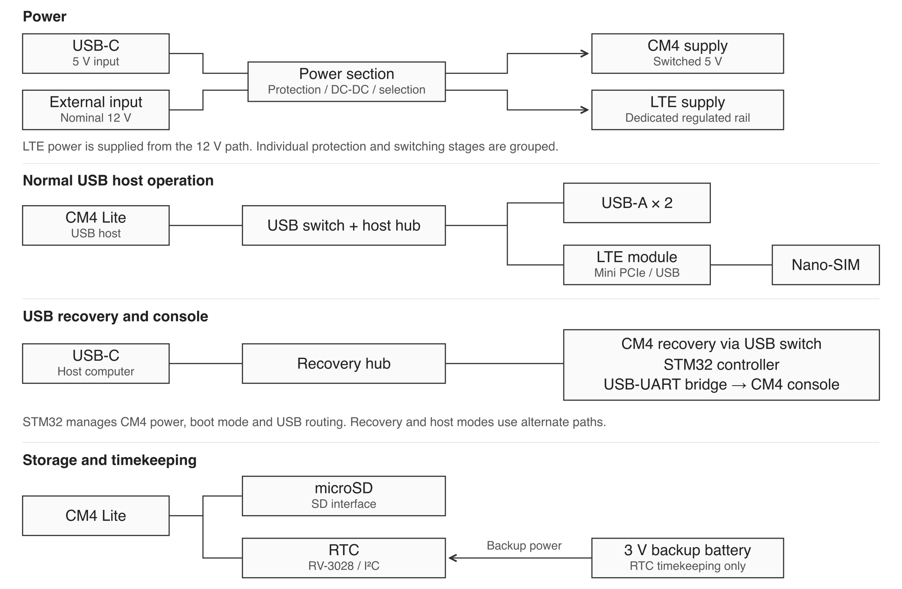

# CM4 Carrier Board

**CM4-MODE-01-SD** is a prototype carrier for the Raspberry Pi Compute Module 4 Lite. It combines USB-C power and data, two USB-A host ports, and microSD storage with an independent STM32 controller for power sequencing and USB recovery.

**PCB dimensions: 75 × 65 mm · 4 layers · 1.6 mm board thickness.** Dimensions refer to the PCB outline and exclude connector overhang and assembled component height.

## Features

- Two USB 2.0 host ports through an onboard hub.
- A microSD slot for CM4 Lite boot media.
- USB recovery access to the CM4 without removing the microSD card.
- STM32F042K6 control of CM4 power, boot mode, and USB routing.
- Unpopulated UART, STM32 boot/reset, and SWD header positions.

The intended input is **5 V / 3 A over USB-C**, shared by the CM4 and peripherals. The controller checks the source's Type-C current advertisement; the board does not negotiate higher USB-PD voltages.

## Interfaces

| No. | Interface | Function |
| --- | --- | --- |
| 1 | CM4 connectors | Two board-to-board sockets for CM4 Lite |
| 2 | USB-C | 5 V power input and USB 2.0 data |
| 3 | USB-A × 2 | Two USB 2.0 host ports sharing one upstream link |
| 4 | microSD | CM4 Lite boot media |
| 5 | Service headers | 3.3 V UART, STM32 BOOT/RESET, and SWD |

See the [interface reference](docs/interfaces.md) for connection details.

## Circuit overview

The USB switch selects the CM4's connection to either the USB-A host hub or the USB-C recovery hub. The STM32 remains accessible through the recovery hub and controls the mode transition. The diagram shows functional paths; component-level wiring is omitted.

## Getting started

Use a CM4 **Lite** module, a prepared microSD card, and a USB-C supply advertising 5 V / 3 A. Install the module and card with power disconnected, and leave the STM32 BOOT/RESET jumper open for normal operation.

With the candidate v2.04 firmware, a 3 A source without a configured USB host permits automatic CM4 startup after approximately five seconds. A PC data connection requires an explicit controller command; the host utility used during development is not included in this repository.

See [startup and power](docs/getting-started.md) before connecting the board.

## STM32 firmware

The hardware-tested candidate is **v2.04 for STM32F042K6**. Firmware downloads will be provided through GitHub Releases after PCB compatibility and the redistribution package are finalized. No firmware binary is distributed in this repository yet.

- [Firmware version and checksum](firmware/README.md)
- [Programming interfaces](docs/flashing.md)
- [USB recovery operation](docs/usb-recovery.md)

## Validation status

| Function | Recorded result |
| --- | --- |
| Normal microSD boot | Login and SSH access confirmed on the development prototype |
| CM4 USB recovery boot | Confirmed with v2.04 |
| microSD access from macOS | Read-only access confirmed through a RAM-loaded USB storage gadget |
| Return from recovery to normal boot | Confirmed |
| Rewriting microSD over USB recovery | Not tested |
| USB-A peripheral load and long-duration operation | Not fully evaluated |

The recorded USB recovery round trip used a Mac port advertising 1.5 A, empty USB-A ports, and an explicitly enabled limited-current test mode. Undervoltage and throttling history was recorded. This confirms the recovery sequence under those test conditions; it does not validate the full load budget with the intended 5 V / 3 A supply.

These results apply to the tested prototype. The photographed board's exact revision and firmware compatibility remain part of the [release preparation](docs/release-status.md).

## Planned open release

I plan to release **this CM4 Carrier Board's editable hardware design files and firmware source code openly** when they are ready. The licenses and release scope will be announced with that release. There is no release date yet.

Support for **Raspberry Pi Compute Module 5 (CM5)** is also planned for a future hardware revision. CM5 compatibility has not yet been validated; the prototype described here targets CM4 Lite.

## Next model: R7

An R7 successor is also in development, adding LTE module support, a nominal 12 V input, an RTC battery connection, and revised power protection.

**PCB dimensions: 85 × 75 mm · 4 layers · 1.6 mm board thickness · components on both sides.** Dimensions refer to the PCB outline and exclude connector overhang and assembled component height.

R7 is a separate development project. Its release plans and licensing have not been decided.

*R7 development previews, visualized with a black solder-mask finish. The component models are illustrative, and the design remains subject to change.*

*Provisional functional overview. Connections and power stages are grouped for clarity; the design is not finalized and may change during development.*

## Images

The prototype photograph and R7 CAD previews were processed with generative image editing for presentation. The prototype image includes a white background and the 2026 copyright marking; the R7 previews have branding and application UI removed. Interface callouts are vector overlays. Use the physical PCB and verified design documentation for pin identification.

## Licensing

The licensing scope and firmware distribution status are described in [LICENSING.md](LICENSING.md). Third-party components are listed in [THIRD_PARTY_NOTICES.md](THIRD_PARTY_NOTICES.md).
