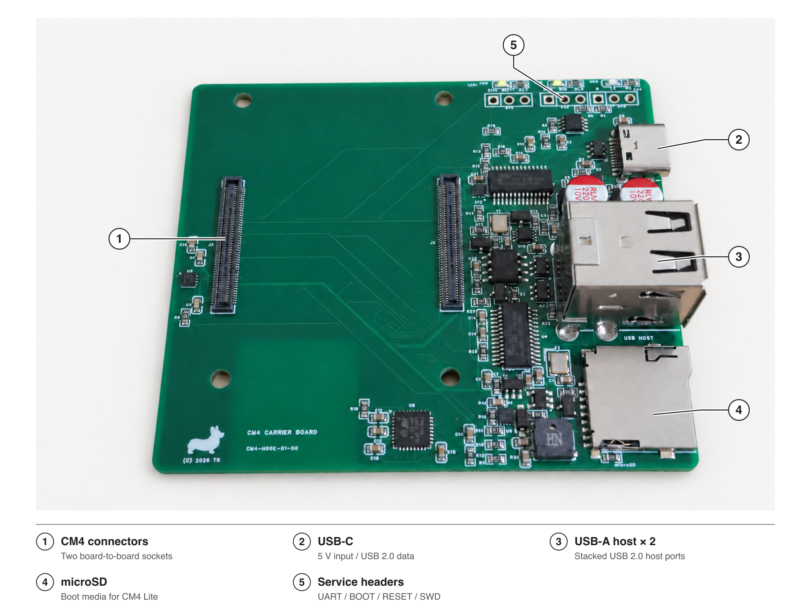

# Interface reference

## 1. CM4 connectors

The two board-to-board sockets accept a Raspberry Pi Compute Module 4 Lite. The onboard microSD slot is intended for the Lite module, which has no onboard eMMC. Disconnect power before installing or removing the module.

## 2. USB-C

USB-C provides 5 V input power and the upstream USB 2.0 connection to the recovery hub. That hub connects the host computer to the STM32 controller and, in recovery mode, to the CM4.

Normal operation expects a source advertising 3 A through the USB-C CC connection. A PC USB port may advertise less current. A data connection also requires a data-capable cable. There is no negotiation for 9 V, 12 V, or other USB-PD voltage profiles.

## 3. USB-A host ports

The stacked connector provides two USB 2.0 host ports for the CM4. Both share one upstream USB 2.0 link and the board's input power budget. The 480 Mbit/s link rate is shared, not available independently to each port.

The host path is selected during normal boot. USB recovery uses the alternate CM4 USB path; the two modes are not simultaneous. Peripheral load and sustained throughput remain to be evaluated on the prototype.

## 4. microSD

The card connects to the CM4 Lite SD interface. The STM32 does not read or write the card directly. During USB recovery, software loaded into CM4 RAM can expose the card to the connected host computer.

Read-only access has been tested. Rewriting the card through recovery has not been tested.

## 5. Service headers

The R2 design provides three unpopulated 2.54 mm, three-pin header positions. Header pins or suitable wires must be fitted before use. The presentation image is not a pin-orientation reference; verify the physical board revision and pin-1 marking before connecting.

| Reference | Purpose |
| --- | --- |
| J4 | CM4 UART, 3.3 V TTL logic |
| J6 | STM32 BOOT0 and reset access |
| J7 | STM32 SWD programming and recovery |

### UART wiring — R2 design reference

TX and RX below are named from the CM4's perspective.

| J4 pin | Signal | USB-UART adapter connection |
| --- | --- | --- |
| 1 | GND | GND |
| 2 | CM4 TX | RX |
| 3 | CM4 RX | TX |

Use a 3.3 V logic adapter. Leave the adapter's VCC lead disconnected. Do not connect RS-232 levels or 5 V logic to these signals. The development setup used 115200 baud, 8 data bits, no parity, and one stop bit; the CM4 operating system must enable its UART console separately.

J6 selects the STM32 boot mode; it is not a CM4 SD-boot selector. Leave its jumper open during normal operation. A numbered J6/J7 wiring diagram will be included after the photographed revision is checked.
